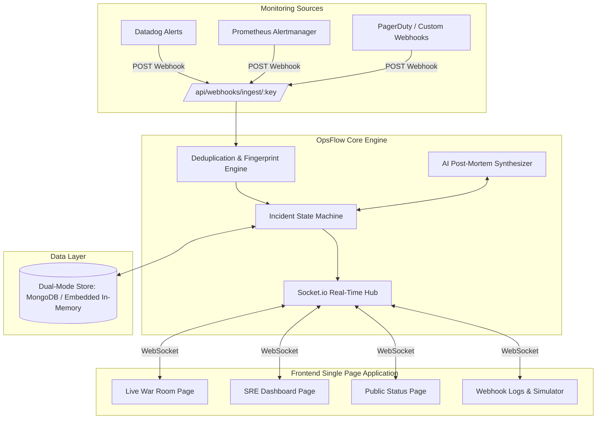

# OpsFlow: Incident Response & Reliability Platform

[](https://reactjs.org/)
[](https://socket.io/)
[](#zero-configuration-dual-mode-persistence)
[](LICENSE)

> **OpsFlow** is an enterprise-grade incident response, alert aggregation, and site reliability engineering (SRE) platform. Built from the ground up to solve alert fatigue, eliminate chaotic communication channels during outages, and minimize Mean Time To Resolution (MTTR).

---

## 🎯 Problem Statement & Value Proposition

During high-severity cloud outages (P1/P0):
1. **Alert Fatigue & Duplication**: Monitoring agents (Datadog, Prometheus, CloudWatch) flood channels with hundreds of redundant alerts.
2. **Fragmented Collaboration**: Teams scramble between Slack, Zoom, and ticketing systems without a centralized timeline or audit trail.
3. **Delayed Post-Mortem Delivery**: Post-incident retrospectives take hours or days to compile manually, resulting in lost institutional learnings.

**OpsFlow solves this through:**
* **Intelligent Webhook Ingestion**: Ingests payloads from any monitoring service, deduplicates alerts using rolling fingerprinting, and auto-routes to on-call squads.
* **Live Incident War Room**: A single pane of glass featuring real-time bi-directional team chat, interactive action checklists, and timeline audit logs.
* **AI-Assisted Post-Mortem Generator**: Automatically aggregates telemetry, action logs, and responder chat to synthesize root cause analyses, 5-Whys, and action items.
* **Public Status Page**: Real-time service component status, ongoing incident communication, and maintenance notices for external stakeholders.

---

## 🏗️ System Architecture



---

## ✨ Key Platform Features

### 1. Multi-Format Webhook Ingestion & Alert Deduplication
* Ingests native alert payloads via `/api/webhooks/ingest/:serviceKey`.
* Fingerprint algorithm correlates service name, error title, and source to prevent duplicate incidents during alert storms.
* Live webhook payload inspector with a built-in interactive simulator modal.

### 2. Strict Incident Lifecycle State Machine
Enforces standard SRE escalation procedures:
$$\text{Triggered} \longrightarrow \text{Acknowledged} \longrightarrow \text{Investigating} \longrightarrow \text{Mitigated} \longrightarrow \text{Resolved}$$
* Real-time calculation of **Mean Time to Acknowledge (MTTA)** and **Mean Time to Resolve (MTTR)**.
* Live escalation timers alerting on-call responders.

### 3. Real-Time Collaborative War Room
* **Bi-directional WebSockets** powered by Socket.io.
* **Live Responder Presence**: See who has joined the room in real time.
* **Synchronized Mitigation Checklist**: Interactive tasks that update across all connected engineers instantly.
* **Live Incident Chat**: Dedicated channel isolating discussion to the active incident.
* **Immutable Audit Timeline**: Records all status changes, responder actions, and key events.

### 4. AI-Powered Post-Mortem Generator
* Evaluates incident telemetry, responder chat, and checklist actions.
* Produces instant post-mortems with:
  * Executive Summary
  * Incident Timeline
  * 5-Whys Root Cause Analysis
  * Preventative & Corrective Action Items
* Editable markdown output with one-click export.

### 5. Public Status Page
* External-facing status dashboard displaying real-time operational status for all core microservices:
  * API Gateway
  * Authentication Service
  * Payment Gateway
  * Database Cluster
  * Notification Service
* Displays scheduled maintenance notices and active incidents.

---

## ⚡ Zero-Configuration Dual-Mode Persistence

OpsFlow is engineered to be **100% evaluator-friendly**:
* If **MongoDB** is running locally (`mongodb://localhost:27017/opsflow`) or provided via `MONGODB_URI`, OpsFlow seamlessly connects to MongoDB via Mongoose.
* If MongoDB is **not installed or stopped**, OpsFlow automatically and transparently activates an **embedded in-memory persistence engine** with zero crashes, zero setup, and zero dependencies required!
* The database auto-seeds on first boot with realistic microservices, past incidents, and active alert scenarios.

---

## 🚀 Quick Start Guide

### Prerequisites
* **Node.js**: v18.0.0 or higher
* **npm**: v8.0.0 or higher

### Installation & Launch

1. **Clone & Install Dependencies**:
   ```bash
   cd "mern end term project"
   npm run install:all
   ```

2. **Start Development Environment**:
   ```bash
   npm run dev
   ```
   * **Backend Server**: `http://localhost:5001`
   * **Frontend UI**: `http://localhost:3000`

3. **Or Run Production Build**:
   ```bash
   npm run build
   npm start
   ```
   * Full-stack application served unified at `http://localhost:5001`!

---

## 🔑 Pre-Seeded Demo Credentials

The database automatically seeds with ready-to-test responder accounts:

| Role | Email | Password | Access Level |
| :--- | :--- | :--- | :--- |
| **SRE Lead / Admin** | `alex@opsflow.internal` | `password123` | Full access to War Rooms, incident resolution, service overrides |
| **On-Call Engineer** | `demo@opsflow.dev` | `demo123` | Responder access, chat, checklist management |

---

## 📡 API Reference Overview

### Health & Analytics
* `GET /api/health` — Service health status and active persistence mode (`mongo` or `embedded`).
* `GET /api/analytics/metrics` — MTTR, MTTA, active incident counts, and SLA metrics.

### Incidents
* `GET /api/incidents` — List all incidents (supports filtering by `status` and `severity`).
* `POST /api/incidents` — Create manual incident.
* `GET /api/incidents/:id` — Get full incident details, timeline, and action items.
* `PATCH /api/incidents/:id/status` — Advance incident lifecycle state.
* `POST /api/incidents/:id/post-mortem` — Trigger AI Post-Mortem generator.

### Webhooks
* `POST /api/webhooks/ingest/:serviceKey` — Ingest third-party monitoring alerts.
* `GET /api/webhooks/logs` — List recent webhook payloads and processing statuses.

### Services & Public Status
* `GET /api/services` — List microservices, SLAs, and current operational states.
* `GET /api/services/status-page` — Public endpoint for the external status page.
* `PATCH /api/services/:id/status` — Manually override service health.

---

## 🧪 Evaluation Test Script: Simulating Live Alerts via cURL

Open your terminal while OpsFlow is running and send a simulated alert payload:

### Example: High Latency Alert on Payment Gateway
```bash
curl -X POST http://localhost:5001/api/webhooks/ingest/payment-gateway \
  -H "Content-Type: application/json" \
  -d '{
    "alerts": [
      {
        "status": "firing",
        "labels": {
          "alertname": "PaymentProcessingLatencyHigh",
          "severity": "critical"
        },
        "annotations": {
          "summary": "Stripe webhook response times exceeded 4500ms threshold"
        }
      }
    ]
  }'
```

**Observation in Browser**:
1. Open `http://localhost:3000/incidents` or the Dashboard.
2. A new **CRITICAL** incident appears immediately without page refresh via Socket.io.
3. Click **"Join War Room"** to collaborate, test the chat, complete mitigation checklists, and generate the AI Post-Mortem!

---

## 📂 Project Structure

```text
mern-end-term-project/
├── client/                     # Frontend React (Vite) Application
│   ├── src/
│   │   ├── components/         # Reusable UI (Navbar, Sidebar, Badges, Modals)
│   │   ├── context/            # SocketContext & AuthContext
│   │   ├── pages/
│   │   │   ├── DashboardPage.jsx   # Metrics, MTTR/MTTA, Active feeds
│   │   │   ├── IncidentsPage.jsx   # Incident grid & triage controls
│   │   │   ├── WarRoomPage.jsx     # Live real-time collaboration
│   │   │   ├── ServicesPage.jsx    # Monitored microservices & SLAs
│   │   │   ├── WebhooksPage.jsx    # Ingestion logs & Simulator
│   │   │   └── StatusPage.jsx      # Public-facing status page
│   │   ├── services/           # Axios API client & audio notifications
│   │   ├── App.jsx             # React router & routing architecture
│   │   └── index.css           # Modern SRE dark mode design system
│   └── vite.config.js          # Proxies /api and /socket.io to port 5001
├── server/                     # Backend Node.js / Express Server
│   ├── src/
│   │   ├── config/             # Environment & port configurations
│   │   ├── controllers/        # REST route handlers
│   │   ├── db/                 # Dual-mode persistence (MongoDB + In-Memory)
│   │   ├── middleware/         # JWT auth & error handlers
│   │   ├── models/             # Mongoose schemas & In-memory models
│   │   ├── routes/             # Express API router
│   │   ├── seeds/              # Database seeder with demo scenarios
│   │   ├── services/           # Socket.io, Deduplication, and AI Post-Mortem
│   │   └── server.js           # Server entry point
│   ├── package.json
│   └── .env.example
├── package.json                # Root orchestration scripts
└── README.md                   # Complete platform documentation
```

---

## 📜 License
This project is submitted as an End-Term Capstone Project and is licensed under the [MIT License](LICENSE).
